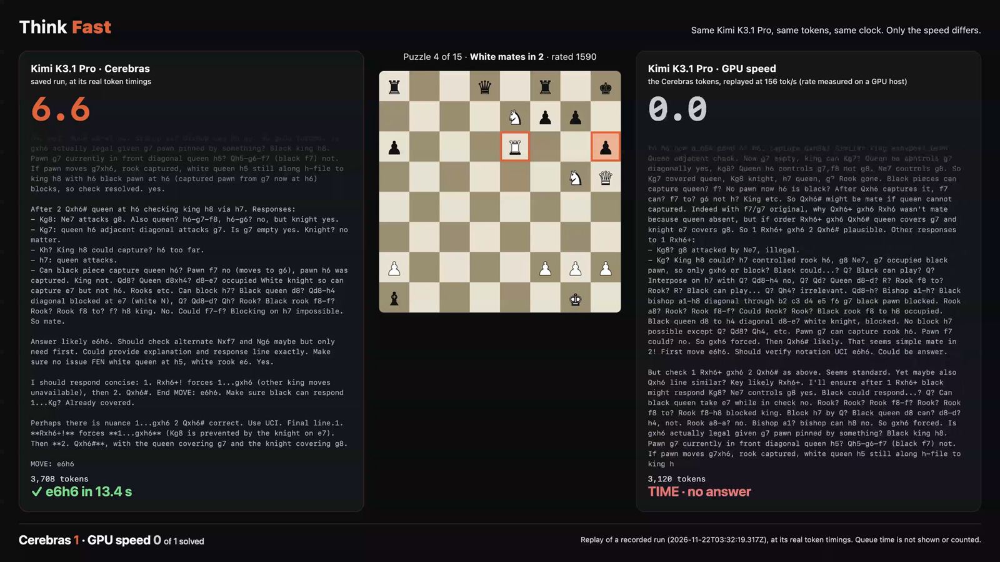

# Think Fast

**Same AI. Same clock. On Cerebras, it gets to think more.**



An [OpenClaw](https://github.com/openclaw/openclaw) plugin that gives the same model, **Kimi K3.1 Pro**, the same 20 seconds on real chess puzzles: once at **Cerebras** speed, once at **GPU** speed. A reasoning model's answer quality depends on how much it can think before time runs out. At a fixed deadline, faster inference is more intelligence: in this run, five more of Kimi's answers fit the clock.

| 15 real Lichess mate-in-2 puzzles, 20 s each | Solved |
| --- | --- |
| Kimi K3.1 Pro on Cerebras | **9 / 15** |
| Same tokens at GPU speed (156 tok/s) | **4 / 15** |

Run of Nov 22, 2026 ([`runs/2026-11-22T03-32-19-317Z.json`](runs/2026-11-22T03-32-19-317Z.json)), every puzzle at 20 s:

| Puzzle | Rating | Tokens (Cerebras, ≤ 20 s)¹ | Cerebras | GPU speed |
| --- | --- | --- | --- | --- |
| [ZLjMR](https://lichess.org/training/ZLjMR) | 1585 | ≈ 5,211 | out of time | out of time |
| [QC2vI](https://lichess.org/training/QC2vI) | 1544 | 1,332 | ✓ `h5h2` in 4.4 s | ✓ in 8.5 s |
| [dRiu4](https://lichess.org/training/dRiu4) | 1430 | 1,617 | ✓ `e1e8` in 5.9 s | ✓ in 10.4 s |
| [XTKWJ](https://lichess.org/training/XTKWJ) | 1590 | 3,708 | ✓ `e6h6` in 13.4 s | out of time (needs 23.8 s) |
| [yL7Tc](https://lichess.org/training/yL7Tc) | 1547 | 4,146 | ✓ `f2f3` in 16.3 s | out of time (needs 26.6 s) |
| [u26bx](https://lichess.org/training/u26bx) | 1589 | 3,715 | ✓ `a4a6` in 12.9 s | out of time (needs 23.8 s) |
| [99Bi0](https://lichess.org/training/99Bi0) | 1415 | 4,265 | ✓ `h7h2` in 14.5 s | out of time (needs 27.3 s) |
| [DgO21](https://lichess.org/training/DgO21) | 1288 | 4,838 | ✓ `d8a8` in 18.1 s | out of time (needs 31.0 s) |
| [yFKBd](https://lichess.org/training/yFKBd) | 1286 | ≈ 5,487 | out of time | out of time |
| [ENL7Z](https://lichess.org/training/ENL7Z) | 1391 | ≈ 5,997 | out of time | out of time |
| [KdZsn](https://lichess.org/training/KdZsn) | 1324 | ≈ 5,360 | out of time | out of time |
| [ysBdx](https://lichess.org/training/ysBdx) | 1391 | ≈ 5,814 | out of time | out of time |
| [HkLOu](https://lichess.org/training/HkLOu) | 1331 | 1,863 | ✓ `c4f7` in 7.0 s | ✓ in 11.9 s |
| [lASiR](https://lichess.org/training/lASiR) | 1455 | 2,697 | ✓ `d5a8` in 9.7 s | ✓ in 17.3 s |
| [qIDtl](https://lichess.org/training/qIDtl) | 1308 | ≈ 4,926 | out of time | out of time |

¹ Where Cerebras ran out of time the stream is cut, so no usage arrives: those counts (≈) are estimates, the characters streamed ÷ 2.95.

This 15-puzzle run came from `bun run race`, the same engine without an agent turn, because Cerebras' shared queue was too busy for a long agent turn at the time. Every delta, move, time and token count is in [`runs/`](runs/), with the two runs the OpenClaw agent started itself (2 puzzles: Cerebras 2/2, GPU speed 1/2; 5 puzzles: 3/5 vs 1/5). Reasoning is sampled, so the same puzzle can land either side of the clock: ZLjMR ran out of time above and was solved in 15.7 s in the agent's 2-puzzle run.

## How it works

```
you ─► OpenClaw agent (Kimi K3.1 Pro on Cerebras): "Think fast: race 5 puzzles"
          └─► think_fast tool
                ├─ for each puzzle (Lichess mate-in-2, CC0): one streaming call to Kimi K3.1 Pro
                │  on Cerebras, reasoning_effort high, cut off 20 s after its first token
                ├─ Cerebras lane: answered if its MOVE line arrives inside 20 s
                ├─ GPU lane: the same tokens at 156 tok/s; answered only if they fit in 20 s
                ├─ grade: the move must force mate in 2 (checked with chess.js, any mating line counts)
                └─ live race page on the Gateway: /think-fast  (board, both lanes, both clocks)
```

- **Same model, same tokens.** The GPU lane is not a different answer: it is the exact token stream Kimi produced, at the decode rate we measured for Kimi K3.1 Pro on a GPU host (Morph via OpenRouter, 156 tok/s first token to last on a 280-token completion, Nov 22, 2026; Parasail measured 83 tok/s the same day, so 156 is the faster of the two GPU hosts we measured). The only thing that changes is speed, so the only question is whether the thinking fits in the clock. No live GPU calls were made: our OpenRouter credit only covered the rate probes.
- **Clocks start at the first token** on both lanes. Queueing and time to first token are not counted for either side (Cerebras' first token took up to 31 s in these runs). During the hackathon, Cerebras' shared queue often answered HTTP 429 first; the tool waits that out before the clock starts.
- **Graded by the rules of chess**, not by string match: a move scores if it is the puzzle's solution or any other move that forces mate in two.
- **Only a committed answer scores.** Pause the XTKWJ race at the GPU lane's TIME and its text already reads "First move e6h6. Should verify notation UCI e6h6. Could be answer.": Kimi was still checking and had not written its `MOVE:` line. Under a deadline only the answer you commit to counts; the speed bought the check.
- **Every run is saved** (`~/.think-fast/runs/`) and replays on the page at its real token timings: `/think-fast?run=<file>`. The runs in this repo replay too, with no API key.

## Run it

Needs Node 24+, Bun, OpenClaw 2026.11.x and a Cerebras API key with Kimi K3.1 Pro access. First time with OpenClaw? Run `openclaw onboard` first.

```bash
git clone https://github.com/Chinteyley/think-fast && cd think-fast
bun install && bun run build

export CEREBRAS_API_KEY=csk-...            # never commit it
openclaw plugins install --link . --accept-capabilities
openclaw config patch --file config/openclaw.json5
openclaw gateway                            # then open http://127.0.0.1:18789/think-fast
```

Ask the agent in the Control UI: **"Think fast: race 5 puzzles."** Or from the terminal, the same engine without the agent: `bun run race 15 0 20` (count, first puzzle, clock in seconds). To watch the 15-puzzle run above without a key: `/think-fast?run=2026-11-22T03-32-19-317Z.json`.

## Measured

- **Cerebras, Kimi K3.1 Pro, reasoning high:** a median of 276 tok/s from first token to answer over the nine puzzles it answered (255–302; e.g. 3,708 tokens in 13.4 s), 1.8× the GPU host's 156. Under the same clock that turned into 2.25× as many puzzles solved (9 vs 4).
- **GPU host, Kimi K3.1 Pro via OpenRouter:** Morph 156 tok/s, Parasail 83 tok/s (first token to last).
- **Kimi's chess:** on Cerebras it solved 9 of 15 mate-in-2 puzzles rated 1286–1590 inside 20 s, and every answer it gave was right; the six misses ran out of time. At GPU speed, five of those nine answers arrive after the clock.

## Test

```bash
bun run test   # the chess grader against the puzzle set, the lane verdicts on a mocked Cerebras stream, and the plugin's registration
```

## Built for

The Cerebras × Kimi K3.1 Pro × OpenClaw weekend hackathon, Nov 21–22, 2026. Puzzles from the [Lichess puzzle database](https://database.lichess.org/#puzzles) (CC0).

#KimiOnCerebras · [@Cerebras](https://x.com/Cerebras) · [@Kimi_Moonshot](https://x.com/Kimi_Moonshot)

## License

MIT
